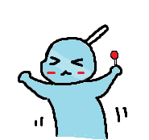

  

    

      
    

    

      <h3 style="margin-top: 20px;">딴짓 경력</h3>
      <ul style="line-height: 1.8;">
        <li><strong>2023) 아주대학교 사이버보안학과 입학</strong></li>
        <li><strong>2026) 육군 정보보호병 병장 만기전역</strong></li>
        <li><strong>2026) WHS 4기 활동</strong></li>
        <li><strong>2026) 팀 Ring0 소속</strong></li>
      </ul>
      <h3 style="margin-top: 20px;">딴짓 분야</h3>
      <ul style="line-height: 1.8;">
        <li><strong>임베디드</strong></li>
        <li><strong>윈도우 커널 1-day 학습</strong></li>
        <li><strong>바이브 코딩</strong></li>
      </ul>
    

  

  

    

      
    

    

      <h2>Contact 📬</h2>
      <ul style="list-style: none; padding-left: 0; line-height: 1.8;">
        <li>📧 Email: <a href="mailto:mokky@mokky.store">mokky@mokky.store</a></li>
        <li>🐙 GitHub: <a href="https://github.com/K-Mokky" target="_blank">https://github.com/K-Mokky</a></li>
      </ul>
      <blockquote style="margin-top: 25px; border-left: 4px solid #007bff; padding-left: 15px; color: #555; background: #f8f9fa; padding: 15px; border-radius: 5px;">
        
Assistance : Gemini, ChatGPT, Claude, Grok

      </blockquote>
    

  

  

    

      <h2 id="copyright">저작권</h2>
      
명시되지 않는 한 이 사이트의 블로그 게시물은 모든 권리가 작성자에게 있습니다.

    

  

